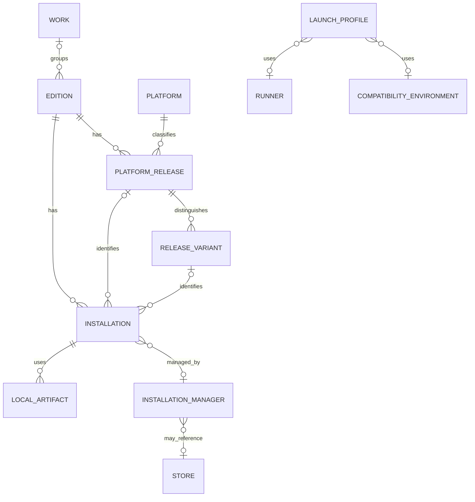
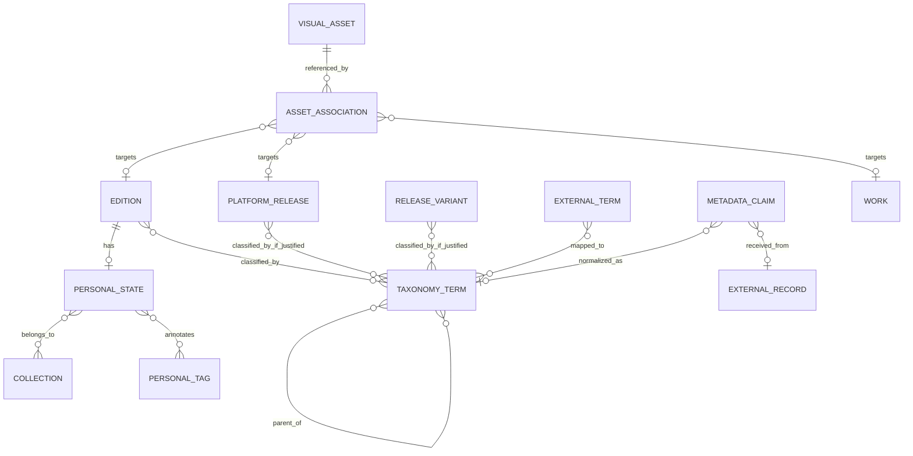
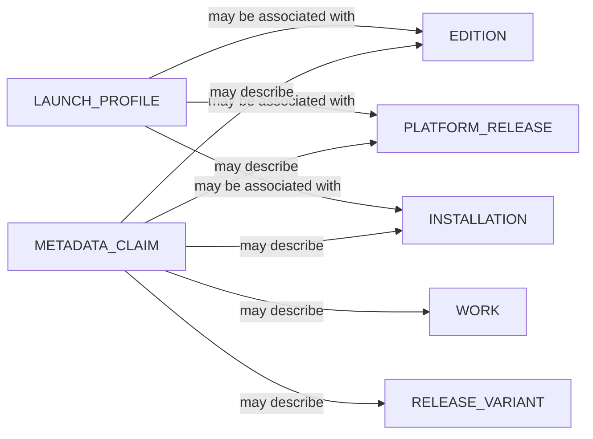

# Kiwanto Library Data Model

**Consolidated conceptual model — SQL implementation status is documented separately**

## 1. Purpose and principles

This document records the conceptual library model and approved requirements. It does not define SQL, migrations, provider APIs, a final taxonomy catalog, or claim that all described application behavior is implemented. The current schema and its status are documented in [DATABASE_AND_BACKUP.md](DATABASE_AND_BACKUP.md).

The model should:

- Give every library edition a stable internal identity independent of its title, provider ID, installation path, or executable.
- Treat a work as an optional grouping concept, not a prerequisite for adding a game.
- Keep platform releases, regional/build variants, concrete installations, and launch profiles distinct.
- Preserve user-owned library and personal data when an installation disappears or metadata changes.
- Retain external values and provenance while allowing reviewed normalization and field-level acceptance.
- Reuse local assets and avoid storing large image binaries in SQLite.
- Provide one query and filtering contract for Desktop Mode and Big Picture, with one result per edition.
- Favor explicit user control, local-first operation, and conservative behavior over automatic matching or destructive cleanup.

The terms **approved** and **proposed** are distinguished throughout:

- **Approved requirements** are decisions explicitly established for this design stage, including the edition as the library item, optional work grouping, multiple releases and installations, independent personal state, canonical taxonomy IDs, provenance, asset files outside SQLite, and faceted filter logic.
- **Proposal** describes a recommended way to realize those requirements. It is not final until reviewed and approved.
- **Open question** identifies a choice that should remain unsettled before implementation.

The current React model is a demonstration contract only. The six demo entries and their in-memory state are not the definitive domain model.

## 2. Identity hierarchy

### 2.1 Work

A **work** is an optional grouping for related editions, such as a franchise entry or a game concept that has several products. It may have a canonical name and relationships to other works, but it is not itself required to appear as a library item.

Work matching must be explicit or reviewed. Similar names, shared characters, or provider relationships are not enough to merge editions automatically.

### 2.2 Edition — the library item

An **edition** is the primary item displayed and organized in the library. It has a stable internal ID and retains its own user state even if it has no known installation or external metadata.

An edition may belong to zero or one work in the initial proposal. A materially different remake, remaster, or product edition may be a separate edition related to the same work. Minor patches and builds normally remain versions or variants of an edition rather than new library items.

The choice to make the edition the library item and the work an optional grouping is **approved**. Exact boundaries for “materially different” remain open.

### 2.3 Platform release

A **platform release** represents an edition released for a distinct originating platform, such as PC, PlayStation 2, Xbox, or SNES. It is not the same as the operating system on which Kiwanto runs or the operating system targeted by an executable.

An edition may have multiple platform releases. A release may carry applicable information such as its release date, supported target operating systems, external identifiers, and release-level metadata.

### 2.4 Release variant

A **release variant** distinguishes a meaningful regional, revision, or software-build variant of a platform release. Examples include a regional PS2 release, a ROM revision, or PC build 1.0 versus 3.0.

Variants do not automatically become separate library editions. They should be modeled separately only when the distinction is known and useful for identification, compatibility, metadata, or user choice. A variant may be unknown; the model must not require every installation to have a confidently identified region or build.

### 2.5 Installation

An **installation** is a concrete installed or user-configured instance associated with an edition and, when known, a platform release or variant. It has an internal identity and its own lifecycle and availability state. A path is an attribute that can change, not the installation's identity.

An installation is not the same thing as the local files or artifacts it uses. Those artifacts may be recorded or referenced separately:

- A ROM can be the principal file used by an emulated-game installation.
- A PC game may require a directory tree containing many files rather than one executable or file.
- Other installation types may use a different combination of local files and directories.

These are game files in user- or manager-controlled locations, not visual assets managed by Kiwanto. Kiwanto should reference them only as needed for installation identification and launch configuration; it must not treat them as artwork or assume ownership of them.

An installation can be discovered, manually configured, moved, inaccessible, missing, uninstalled, or otherwise unknown. A missing installation must not delete its edition, personal state, metadata, artwork associations, or history. Multiple installations of one edition are allowed.

The exact state vocabulary and transitions remain open. The model should distinguish “not installed” from “a previously known installation is not found” and from “availability cannot currently be determined.”

Installation managers and other tools should be represented as references to or origins of a local installation, not as the installation identity itself. When multiple managers point to the same local game files, their management references and known origins can relate to one local installation instead of creating one installation per manager. Matching should avoid automatically asserting identity when the evidence is ambiguous. A general deduplication and reconciliation policy for overlapping or shared files remains to be defined.

### 2.6 Launch profile

A **launch profile** is a user-configured way to start an edition or installation. It is separate from the installation and may refer to a particular installation, release, or edition when no installation is available yet.

It may describe an executable or launch target, structured argument list, working directory, environment, runner, compatibility configuration, and any applicable prefix. These are configuration values, not proof that a process was started or that a game session occurred.

### 2.7 Execution and source concepts

Keep the following dimensions separate:

| Concept | Meaning | Example |
|---|---|---|
| Originating platform | Hardware/software platform for which the release was published | PC, PS2, Xbox |
| Target operating system | OS the native executable targets, when applicable | Windows, Linux |
| Host operating system | OS running Kiwanto and the launcher process | Linux |
| Compatibility layer | Tool/configuration that enables a different target to run on the host | Proton, Wine |
| Runner/emulator | Program that interprets or executes the game/release | PCSX2, RetroArch, Dolphin |
| Installation manager | Tool that installed or manages a concrete installation | Steam, Lutris, Heroic, Bottles |
| Store/acquisition source | Store or origin from which the user obtained the game, if known | Steam store, GOG |

These roles may be supplied by one product in a particular workflow, but their meanings should not be collapsed. A source may be unavailable, unrecognized, or manually configured.

The host OS is generally runtime context rather than a required property on every game. A small Big Picture badge is an optional presentation preference and must distinguish originating platform, target operating system, and host operating system rather than collapsing them into one label. For example, a Windows-target game launched through Proton while Kiwanto runs on Linux remains a Windows-target release on a Linux host; it is not thereby a Linux-native game.

## 3. Taxonomy and normalization

Detailed taxonomy and filter rules are consolidated in [TAXONOMY_AND_FILTERS.md](TAXONOMY_AND_FILTERS.md); this section records their place in the wider library model.

### 3.1 Canonical terms

Genres and subgenres should be represented by stable internal term IDs, not by their displayed strings. A term should have a kind (genre or subgenre) and localized labels where needed. Translated labels and aliases name the same canonical term; they must not create duplicate canonical terms. A game may have multiple genres and multiple subgenres simultaneously.

Taxonomy associations normally belong to the edition. When a real, justified difference exists for a particular platform release or release variant, associations may be scoped more narrowly to that release or variant. This does not require copying identical edition-level associations onto every release or variant.

The approved hierarchy is a directed acyclic graph (DAG), not a tree-only structure. A term may have multiple parents, and a subgenre may relate to more than one genre when the relationships are meaningful. Cycles are not permitted. For example, a Survival Horror subgenre may relate to both Horror and Survival; this illustrates the model and does not establish a final genre catalog.

Associations are normally made at edition scope. A justified difference may be recorded at platform-release or release-variant scope without copying unchanged edition associations. Work-level taxonomy associations are not established as a requirement; whether to support them and how inheritance would work remain open. No association should be inferred across editions solely because they share a work.

No final list of genres or subgenres is approved here.

### 3.2 Hierarchy and filter behavior

Selecting a parent genre includes its descendants by default. The user must also be able to restrict the filter to the exact selected term, excluding descendants. For a DAG, descendant matching follows every reachable child relationship; a subgenre with multiple parents is therefore reachable through each relevant parent. Results remain unique by edition even when multiple associated terms or paths match.

These are approved conceptual query rules. Their UI, query syntax, and implementation are not yet defined.

### 3.3 Personal tags

Personal tags are free-form, user-customizable annotations independent of canonical genres and subgenres. Examples include “childhood”, “play someday”, “difficult”, and “play with friends”. Tags can be used in search and filters, but must not silently become canonical terms or official categories. Multiple selected personal tags match with OR by default; an advanced AND mode may be considered later.

### 3.4 External terms and mappings

For each imported taxonomy value, preserve the provider, provider's external term/identifier when available, original spelling, and language. Normalize a clear, reliable equivalence automatically to one or more canonical terms. Leave ambiguous equivalences pending review, and do not create canonical terms automatically for unknown provider values. Users must be able to correct mappings and associations.

The received source term and its provenance remain available after normalization. A manual correction must remain distinguishable from a provider mapping and must not be silently replaced by later normalization.

Examples of normalization behavior, not a final taxonomy catalog:

- “Racing” and “Auto Racing” may map to “Racing/Carreras”.
- “Car Simulation” may relate to a racing genre and a simulation subgenre; it should not automatically be reduced to either one.
- “Point-and-click” may be a subgenre/style associated with Adventure.
- “Survival Horror” may be represented as a subgenre related to both Horror and Survival; this example does not establish a final taxonomy catalog.
- “Puzzle” may map to “Puzzles/Puzles”.

### 3.5 Identity and aliases

Alternate titles, localized titles, former names, and provider-specific names should be treated as names/claims associated with an entity, with language and provenance as applicable. They are useful for search and matching, but do not constitute identity keys.

## 4. Metadata and provenance

### 4.1 Values received, normalized, and accepted

For a metadata field, distinguish:

1. **Received value:** the exact value or term returned by a provider or entered through an import.
2. **Normalized value:** an interpretation mapped to Kiwanto's canonical representation, without discarding the received value.
3. **Accepted value:** the value currently used by the library presentation and queries, selected from a source or entered/edited manually.

An accepted value should retain a link to its origin where practical. Manual edits are their own source of accepted data and take precedence over unattended provider refreshes.

### 4.2 Field-level claims

Metadata provenance is required per field where relevant, not just per whole game record. A conceptual claim should be able to identify:

- Target entity and field.
- Received value and language.
- Provider/source and external record ID, if applicable.
- Retrieval or edit time.
- Normalization/mapping applied.
- Attribution or usage information when required.
- Whether a user accepted, rejected, or manually edited the value.

For multi-valued fields (developers, genres, languages, and similar), provenance should be traceable to individual values or associations where needed. The storage format and retention of full provider responses remain open and must respect source terms.

### 4.3 Applying provider results

Provider search should present results for review and allow values from different providers to be accepted independently, field by field. A selected provider's missing field must not clear an existing value. A manual edit must not be silently overwritten. Applying an approved set of changes should be atomic so an error cannot leave a partial, inconsistent update.

### 4.4 Entity scope and language

Fields must be assigned to the narrowest appropriate entity:

- Work-level facts describe the shared conceptual work.
- Edition-level facts describe the product the user recognizes in the library.
- Platform-release or variant facts describe a particular release, region, revision, or build.
- Installation-specific facts describe local files, paths, or detection.

The exact field-to-entity mapping remains to be approved. A title change from a provider should not automatically rename a user's library entry.

Translations of descriptions and other textual metadata should preserve source language, target language, original text, translated text, and provenance as permitted. UI localization remains separate from game-content language and translation.

## 5. Personal state, collections, and history

### 5.1 Personal state

Favorite status, personal rating, notes, and similar annotations belong to the user's library relationship with an edition, not to an installation or provider record. The initial local application may have one personal context; whether to model multiple local profiles from the start is an open decision.

Collections may be manual or, if implemented later, rule-based. Collection membership should not be confused with taxonomy membership. The representation and refresh policy for dynamic collections remain open.

### 5.2 Installation and removal

Uninstalling or losing files changes installation availability only. It must not remove the edition, personal state, accepted metadata, artwork references, collection memberships, or history. Removing an edition from the visible library and deleting its underlying data are distinct operations; exact archive/restore and deletion semantics require approval.

### 5.3 History and playtime

Keep these concepts distinct:

- Launch request/attempt.
- Process creation result or later process observation.
- Play session measured by Kiwanto under explicit rules.
- Time or history imported from another source.
- Estimated duration such as expected completion time.

Each measurement/import/estimate should retain its source, time scope, and confidence/type. Estimates and imported values must not silently be counted as Kiwanto-measured playtime. Aggregation across installations and sources requires an explicit policy.

## 6. Artwork and visual resources

### 6.1 Asset and association

Separate a **visual asset** (the local file/resource) from its **association** (what it represents and where it is used). An asset may be a cover, background, banner, logo, screenshot, disc image, icon, or future type.

An association may target a work, edition, platform release, or variant, and records the resource role, optional locale/region, source, attribution/license information when known, and whether it is selected for a presentation role.

One asset may be associated with multiple targets when appropriate. Replacing the selected cover should not silently delete another association or the underlying file if it remains referenced.

### 6.2 Files and metadata

Image and other large binary files remain outside SQLite. The database holds local references and descriptive/technical metadata such as media type, dimensions, format, provenance, attribution, and content fingerprint if useful. User-managed original files must not be moved or removed without an explicit, validated operation.

Content hashes may help deduplicate byte-identical managed assets; they are not game identities. Deduplication must respect distinct attribution, licensing, or lifecycle metadata and must not merge distinct files solely because they depict the same game.

The asset directory, cache, backup inclusion, fingerprint algorithm, cleanup policy, and handling of provider licensing restrictions remain open.

### 6.3 Presentation preferences

The Big Picture platform/system badge is derived presentation, enabled or disabled by a UI preference. The absence of an icon or a missing platform value must not make a game invalid. Artwork selection, theme assets, and game assets remain separate concerns.

## 7. Search and filtering

The query layer should be shared by Desktop Mode and Big Picture. Views may expose different controls, but must not implement separate filter semantics. The approved rules below describe future behavior; they do not describe the current prototype.

### 7.1 Facet combination

The approved initial rule is:

- **OR within one facet:** selecting PC or PS2 matches either value.
- **AND across facets:** selecting PS2 and Horror requires both conditions.
- Multiple selected personal tags use OR by default. An advanced AND-between-tags option is a future possibility, not part of the initial rule.
- A text query further narrows results along with the active facets.
- Matches are resolved to unique editions. Multiple matching releases or installations do not duplicate an edition in the library result.

More advanced operators such as user-controlled AND/NOT within one facet should wait until there is a concrete need.

### 7.2 Candidate facets

Potential facets include:

- Originating platform.
- Target operating system.
- Runner/emulator.
- Compatibility layer/environment.
- Genre and subgenre.
- Personal tags.
- Favorite state.
- Installation/availability state.
- Collection membership.

For genre and subgenre facets, selecting a parent includes all reachable descendants by default. An exact-term option excludes descendants. When several values are selected in the same facet, their matches are combined with OR; the resulting facet is ANDed with other active facets. Multiple paths through the DAG, or multiple matching associations on one edition, must not produce duplicate results.

Personal tags are searchable and filterable as their own facet; they are not merged into genre or subgenre facets. Exact query syntax and how free-text input resolves taxonomy labels, aliases, and personal tags remain implementation and UX questions.

A platform, runner, store, or compatibility facet should query its own concept, not reuse one generic “platform” field.

Initially showing facet options that occur in the current library is a useful proposal. The UI should still make clear when no values are available and should not imply that a hidden value is unsupported. Whether to include zero-result choices or an “all values” mode is open.

### 7.3 Installation aggregation

An edition can have several installations and releases. Filtering by “available/installed” should match an edition if at least one relevant installation satisfies the condition. Missing one installation should not mask another available installation.

The exact definitions and precedence for “not installed,” “not found,” “unknown,” and “available through an external client” require approval. Do not treat a configured launch profile by itself as proof that files are currently installed.

### 7.4 Examples

| Query/facets | Expected conceptual result |
|---|---|
| Platform = PS2 OR Xbox | Editions with at least one PS2 or Xbox release, each appearing once. |
| Platform = PS2 AND genre = Horror | Editions with a PS2 release and an accepted Horror taxonomy association. |
| Platform = PC OR PS2, favorite = true | Favorite editions with at least one selected platform release. |
| Target OS = Windows AND compatibility = Proton | Editions with a Windows-target release and a matching Proton launch configuration; the host OS remains a separate runtime fact. |
| Collection = Backlog AND availability = not installed | Backlog editions with no qualifying available installation under the approved aggregation rule. |
| Text = “San Andreas” AND platform = PS2 | Editions matching the text and having a PS2 release; a distinct Definitive Edition appears only if it independently meets the criteria. |
| Genre = Adventure, include descendants | Editions associated with Adventure or any reachable subgenre appear once. |
| Genre = Adventure, exact term | Only editions associated with the Adventure term itself match; subgenre-only associations do not. |
| Genre = Horror AND platform = PS2, with tag = “play with friends” | PS2 editions matching Horror and carrying that personal tag; other genres/tags do not satisfy the missing facet. |

The current prototype's `@` search is narrower: it searches title text and the present demo genre/system/state values. It has no normalized facets, collection filters, or release/install joins. Its syntax is not the final query contract.

## 8. Conceptual relationships

The following ER diagram is a proposal for the main identity and launch relationships. Exact cardinalities for launch profiles and variants remain subject to review; possible launch-profile associations are shown separately below without cardinalities.

The following ER diagram shows user-state, taxonomy, metadata-source, and asset concepts without prescribing tables:

The following conceptual associations deliberately show no cardinalities or relational implementation:

These diagrams communicate conceptual separation and possible associations, not an approved physical schema. A data claim may target different entity types; the exact relational representation must preserve referential integrity without an unvalidated polymorphic-key shortcut.

## 9. Practical examples

### 9.1 GTA San Andreas: PC 1.0 and 3.0, PS2, and Xbox

Use one optional **work** for the shared conceptual title and an **edition** for the original *GTA San Andreas* product. That edition has platform releases for PC, PS2, and Xbox. The PC release may have variants/build records for 1.0 and 3.0; PS2 and Xbox have their own releases and can have regional variants if identified.

The PC builds are not separate library editions merely because their version numbers differ. The library shows one edition by default; a user may inspect/select a release or variant where relevant to installation or launch.

### 9.2 GTA San Andreas Definitive Edition

Represent this as a separate **edition** related to the same work. Its platform releases and installations are independent. Shared work identity does not merge metadata, artwork, favorite state, or launch configuration between editions.

### 9.3 PS2 game with regional variants

Use one edition and a PS2 platform release. Known regional releases are variants associated with that release. A physical/disc image or installation can point to a known variant; if region is unknown, leave it unresolved rather than inventing one.

### 9.4 ROM with multiple revisions

Use the edition and platform release for the game, with known ROM revisions represented as variants. The ROM file is a local game artifact used by an emulated-game installation; it is not itself Kiwanto-managed visual artwork. Its location and possibly a content fingerprint can help identify the artifact, but its filename or hash alone does not establish the game's identity. Region/revision matching remains evidence-based and reviewable.

### 9.5 Same PC edition installed via Steam and Lutris

Use one edition and PC release. Represent each distinct local game instance as an installation, with its game files or directory tree as separate local artifacts/references. Record Steam and Lutris as manager references and possible origins for the installation, not as different game identities or automatic evidence of two installations. If both tools refer to the same files, associate both references with one installation when that correspondence is established rather than creating duplicate installations merely because the manager differs. If correspondence is ambiguous, do not merge automatically. A broader policy for detecting, reconciling, or separating shared and overlapping installations remains pending.

### 9.6 Windows game launched through Proton on Linux

The edition has a PC platform release targeting Windows. Kiwanto's host is Linux at runtime. The installation records its local game artifacts and location separately from the source/manager reference; a launch profile refers to Proton as its compatibility environment and may use a runner/manager integration as appropriate. A Big Picture badge may show these dimensions distinctly, but must not label the release “Linux-native” because it runs on a Linux host.

### 9.7 Uninstalled game retained in the library

The edition, accepted metadata, artwork associations, personal state, collections, and history remain. Its installation can be marked uninstalled or not found according to explicit state transitions. No executable or directory is deleted merely because a path is missing.

## 10. Risks and special cases

- **Same titles:** stable IDs and reviewed matching are essential; titles are not unique.
- **Renames/localized names:** retain aliases and language/provenance; do not change identity when the displayed title changes.
- **Regional editions:** distinguish a separate edition only when the product/content warrants it; otherwise use a release variant.
- **Remakes/remasters:** relate editions through a work but preserve separate identities when substantially different.
- **Build churn:** too many patch-level variants can clutter the library; decide which versions are user-visible and which remain installation metadata.
- **Multiple installations:** a source may duplicate or point at shared files. Needs a policy for installation ownership and detection.
- **Moved or missing files:** paths are mutable; re-discovery must not silently rebind or erase a user's configuration.
- **Provider disagreement:** values can conflict by field, language, release, or entity scope. Preserve claims and require review for ambiguous identity.
- **ROM identity:** filenames, checksums, region labels, and provider records can disagree; hashes assist file matching but do not prove game identity.
- **Taxonomy ambiguity:** one source term may have several meanings; unknown terms must remain unresolved rather than polluting canonical categories.
- **Shared artwork:** asset deduplication must not lose attribution, rights restrictions, or different associations.
- **Installation aggregation:** an edition may have both available and missing installations. Facets need explicit aggregation semantics.
- **Profile vs installation:** a valid profile does not prove that the target executable still exists or that the game ran.
- **History and playtime:** attempted launches, measured sessions, imported time, and estimates can be confused unless type/source are explicit.
- **Deletion and backups:** cascading removal could erase user state or history. Archive, detach, and permanent-delete behavior needs a reviewed policy.
- **Single-user assumption:** the app is local-first, but whether personal state is scoped to one local profile or designed for multiple profiles is not decided.

## 11. SQLite implementation considerations

This section identifies design needs only; it is not a schema or migration.

### 11.1 Relational integrity

- Use stable internal IDs and explicit foreign-key relationships.
- Do not impose global uniqueness on titles, paths, or executable names.
- External identity uniqueness, if applicable, should be scoped by provider and identifier namespace.
- Many-to-many relationships need duplicate-prevention constraints.
- Deletion rules must protect personal state, history, and still-referenced resources.
- Enforce taxonomy acyclicity and valid release/installation references in the domain layer; some constraints may also be represented relationally.
- Apply multi-field metadata acceptance and related association changes transactionally.

### 11.2 Query and index needs

Candidate indexes to evaluate include:

- Edition title and searchable aliases, including normalized forms if needed.
- Provider + external namespace + external ID.
- Release platform and variant identifiers.
- Installation-to-edition/release associations and availability state.
- Taxonomy term relationships and edition associations.
- Collection membership and personal state.
- Asset content fingerprints and target/type associations.
- Time-bounded history/session queries.

Text-search technology, collation, accent handling, and index maintenance require validation against the expected library size and query needs. Do not add a specialized search index before measurement just because it is available.

### 11.3 Data outside SQLite

Keep artwork and other large binary assets in managed local files, with references and metadata in the database. Executables, ROMs, and game data remain in user or manager-controlled locations; the library database must not become an implicit file manager. Provider credentials, if ever required, need a separately approved secure-storage design.

Backup/restore must account for asset references and any included asset files consistently. SQLite's journal/WAL behavior must be considered; copying only the main database file is not automatically a consistent backup.

### 11.4 Implemented initial schema

The versioned SQLite schema and its implementation status are documented in [DATABASE_AND_BACKUP.md](DATABASE_AND_BACKUP.md). It uses editions, platform releases, installations, and launch profiles as separate entities, and does not add an `installed` column to editions. The migration includes additional structures for future capabilities whose management operations remain unimplemented. The current editor selects canonical taxonomy IDs from a small controlled catalog; previous free-text terms and associations remain pending rather than being promoted or deleted. This conceptual document does not define or supersede the SQL schema.

## 12. Decisions still required for future behavior

The first SQLite migration exists, but it does not resolve every product rule or implement every related capability. These questions remain open for future review and migrations:

1. Exact identity boundary for an edition versus a materially different edition/remake/remaster.
2. Whether work grouping allows one edition to relate to multiple works, and how franchise/series relationships differ from work identity.
3. Which regional, ROM-revision, and software-build distinctions are first-class variants versus attributes kept only on an installation.
4. Whether platform releases can share a variant/build entity or need distinct version concepts for console releases and PC builds.
5. Installation identity/deduplication when two managers refer to the same files, and behavior when installations move.
6. Exact installation availability states and aggregation rules across multiple installations.
7. Detailed launch-profile behavior, including which installation to use when a profile has more than one applicable reference and how profile environment values are validated and protected.
8. Which concepts are persisted catalogs (platform, OS, runner, manager, compatibility layer) versus provider-supplied values that remain unmapped until reviewed.
9. How to expand and govern the canonical catalog and provide advanced hierarchy navigation and filtering; whether to include a future AND-between-personal-tags mode.
10. Whether collection rules are evaluated dynamically or materialized, and how missing/unknown installation states affect them.
11. Which metadata fields belong to work, edition, release, variant, or installation; per-field claim retention and localization policy.
12. How a local personal profile is represented and whether multi-profile support is required now.
13. Playtime aggregation across installations/providers and the confidence/retention policy for sessions and imported history.
14. Asset management ownership, deduplication scope, backup policy, and provider-specific licensing/attribution lifecycle.
15. Archive restoration and backup behavior across future related data and external asset files.

The existing migration records implementation choices for the current version. Any future schema change must preserve stable IDs and user data through versioned migrations rather than treating this conceptual proposal as a substitute for the implementation.
